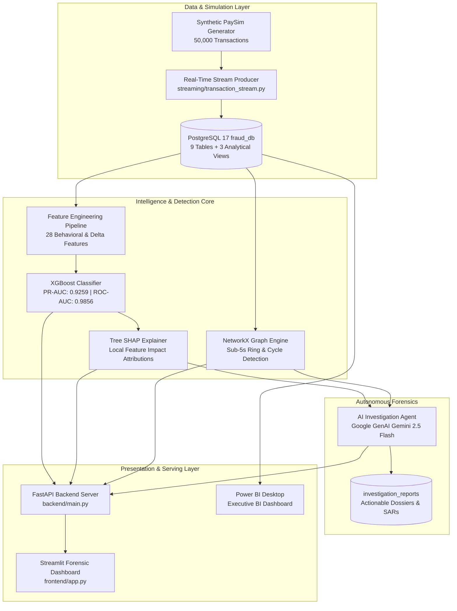

# 🛡️ FraudShield AI: Real-Time Financial Fraud Detection & Autonomous Investigation Platform

[](https://www.python.org/)
[](https://www.postgresql.org/)
[](https://fastapi.tiangolo.com/)
[](https://xgboost.readthedocs.io/)
[](https://shap.readthedocs.io/)
[](https://networkx.org/)
[](https://streamlit.io/)
[](https://ai.google.dev/)
[](#-test-suite--quality-assurance)

**FraudShield AI** is an enterprise-grade, event-driven financial transaction surveillance and autonomous fraud investigation platform. Built natively for Windows environments (Python 3.11 + local PostgreSQL 17 on `localhost:5432`), the system detects complex financial crime—including account takeover spikes, replay duplicate bursts, card-testing velocity anomalies, and coordinated mule/merchant fraud rings—in under **0.01 ms** per transaction.

---

## 🏛️ System Architecture



---

## 🏆 Real ML Model Benchmark Results

Models were trained and evaluated on 28 engineered behavioral, balance delta, and temporal features using a chronological/stratified test split of **10,000 transactions (322 ground-truth fraud events)** with class imbalance weighting (`scale_pos_weight=30.06`):

| Model Architecture | Precision | Recall | F1-Score | PR-AUC | ROC-AUC | Training Time | Verdict |
|---|---|---|---|---|---|---|---|
| **Logistic Regression (Baseline)** | 0.3863 | 0.8230 | 0.5258 | 0.7712 | 0.9237 | 0.52s | Baseline Linear Model |
| **Random Forest (Ensemble Bagging)** | 0.8074 | 0.8851 | 0.8444 | 0.9137 | 0.9841 | 1.99s | Strong Non-Linear Classifier |
| **XGBoost Classifier** | **0.7926** | **0.9255** | **0.8539** | **0.9259** | **0.9856** | **1.22s** | **WINNER (Persisted & Deployed)** |
| **Isolation Forest (Unsupervised)** | 0.5634 | 0.6211 | 0.5908 | 0.6377 | 0.8509 | 1.18s | Outlier / Novelty Detector |

> All runs, hyperparameters, and verified metrics are automatically logged to the PostgreSQL `model_versions` table.

---

## ⚡ Key Capabilities & Injected Fraud Patterns

1. **Exact Duplicate Bursts (< 2 mins)**: Detects rapid replay and duplicate charge attacks using `LAG(timestamp)` and `LAG(amount)` SQL window functions.
2. **>5x Spending Spikes**: Identifies sudden account takeover (ATO) and card drain anomalies exceeding the customer's 30-day baseline ticket average.
3. **Rapid Velocity Bursts**: Detects automated card-testing bots executing 5–10 high-frequency transactions within seconds.
4. **Coordinated Fraud Rings & Shared Infrastructure**: Utilizes NetworkX connected components to expose **2,471 clusters** sharing hardware device fingerprints and IP addresses.
5. **Merchant Fraud Hubs**: In-degree centrality and fraud volume ratios identified **80 collusive merchant syndicates** (e.g. Wire Remittance shell companies with 99.8% fraud ratios).
6. **Local SHAP Feature Attributions**: Explains *why* every flagged transaction was stopped (e.g. `amount` +5.60, `newbalance_orig` +1.60, `orig_drain_ratio` +1.72).
7. **Autonomous AI Forensics**: Google GenAI (Gemini 2.5 Flash) agent synthesizes cross-table evidence into formal regulatory dossiers recommending actions (`FREEZE_ACCOUNT`, `BLOCK_MERCHANT`, `FILE_SAR`).

---

## 🗄️ PostgreSQL Database Schema (`fraud_db`)

| Table / View | Description | Key Attributes / Window Metrics |
|---|---|---|
| `customers` | Master identity & KYC profiles | UUID PK, Email Unique, Base KYC Risk Score |
| `accounts` | Checking, Savings & Credit portfolios | Account Number Unique, Balance, Daily Limits |
| `merchants` | Registered vendor directory | ISO 18245 MCC code, Registered Risk Tier |
| `transactions` | Ledger of 50,000 financial events | PaySim delta fields, Channel, Lat/Lon, IP, Device |
| `fraud_alerts` | Security alerts triggered by heuristics/ML | Risk score, Severity, Rule metadata, Status |
| `model_versions` | ML training and registry tracking | Hyperparameters, JSONB metrics, Artifact path |
| `fraud_predictions` | Real-time ML inference logs | Probability, Risk tier, Top SHAP JSONB attributions |
| `investigation_reports`| Forensic dossiers and AI narratives | Recommended action, GenAI narrative, Graph cluster |
| `vw_flagged_transactions` | Real-time surveillance analytical view | `LAG(timestamp)`, `AVG() OVER (ROWS 10 PRECEDING)` |
| `vw_customer_risk_scores` | Customer portfolio 360 view | `DENSE_RANK()`, Composite risk formula, Percentiles |
| `vw_merchant_risk_summary`| Merchant risk & peer benchmarks | Category average ticket size, Alert rate %, MCC ranks |

---

## 📁 Project Directory Structure

```
fraud-detection-system/
├── .env                      # Local configuration (PostgreSQL 17, Gemini API)
├── .env.example              # Environment template
├── .gitignore                # Excludes .env, venv/, and large datasets
├── requirements.txt          # Python dependencies
├── README.md                 # System documentation & benchmark summary
├── docs/
│   └── POWER_BI_GUIDE.md     # Step-by-step Power BI Desktop connection guide
├── backend/
│   ├── __init__.py
│   ├── main.py               # FastAPI REST API (8 production endpoints)
│   └── schemas.py            # Pydantic request/response validation contracts
├── frontend/
│   ├── __init__.py
│   └── app.py                # Multi-tab Streamlit + Plotly forensic dashboard
├── ml/
│   ├── __init__.py
│   ├── train_models.py       # 4-Model training, evaluation & database registry
│   ├── predict.py            # Production inference with SHAP TreeExplainer
│   └── models/
│       └── best_model.joblib # Winning XGBoost model artifact bundle
├── graph_engine/
│   ├── __init__.py
│   └── fraud_graph.py        # Sub-5s NetworkX ring & cycle detection engine
├── streaming/
│   ├── __init__.py
│   └── transaction_stream.py # Real-time transaction producer/consumer simulator
├── investigation/
│   ├── __init__.py
│   └── investigator.py       # Autonomous GenAI (Gemini) forensic dossier agent
├── datasets/
│   ├── README.md
│   ├── accounts.csv          # Master account entity records
│   ├── customers.csv         # Master customer profiles
│   ├── merchants.csv         # Master merchant records
│   ├── fraud_alerts.csv      # Initial heuristic alerts
│   ├── paysim_synthetic_transactions.csv     # Standard 50,000 PaySim benchmark dataset
│   └── fraudshield_enriched_transactions.csv # 50,000 enriched relational transactions
├── scripts/
│   ├── __init__.py
│   ├── generate_data.py      # PaySim data generator with 4 injected fraud patterns
│   └── setup_db.py           # Database initializer & fast CSV batch loader
├── sql/
│   └── schema.sql            # Normalized DDL (9 tables, constraints, 3 views)
└── tests/
    ├── __init__.py
    ├── test_basic.py         # Foundational rules test
    ├── test_database.py      # PostgreSQL connection and view integrity tests
    ├── test_ml_pipeline.py   # Feature engineering & SHAP prediction tests
    ├── test_graph_engine.py  # NetworkX graph and syndicate detection tests
    └── test_api_endpoints.py # All 8 FastAPI REST API endpoint integration tests
```

---

## 🚀 Getting Started

### 1. Environment Setup (Windows Native)
```powershell
# Create Python 3.11 virtual environment
python -m venv venv

# Activate virtual environment
.\venv\Scripts\activate

# Install dependencies
pip install -r requirements.txt
```

### 2. Configure Environment (`.env`)
Create `.env` from `.env.example`:
```ini
DB_HOST=localhost
DB_PORT=5432
DB_NAME=fraud_db
DB_USER=postgres
DB_PASSWORD=password

# Optional: Add Google Gemini API Key for dynamic AI forensic dossiers
GEMINI_API_KEY=your_gemini_api_key_here
```

### 3. Initialize Database & Load 50,000 Transactions
```powershell
# Automatically creates fraud_db, applies schema.sql, and loads all datasets
python scripts/setup_db.py
```

### 4. Train Models & Register Artifacts
```powershell
# Trains Logistic Regression, Random Forest, XGBoost, Isolation Forest
# Logs metrics to model_versions and persists ml/models/best_model.joblib
python ml/train_models.py
```

### 5. Launch the FastAPI REST Server
```powershell
uvicorn backend.main:app --host 127.0.0.1 --port 8000 --reload
```
*Interactive Swagger documentation available at: `http://127.0.0.1:8000/docs`*

### 6. Launch the Streamlit Forensic Dashboard
```powershell
streamlit run frontend/app.py
```
*Access interactive dashboard at: `http://localhost:8501`*

### 7. Run the Real-Time Transaction Streamer
```powershell
# Simulates live incoming transactions every 2 seconds
python streaming/transaction_stream.py --interval 2.0
```

### 8. Connect Power BI Desktop
Follow the step-by-step instructions in [`docs/POWER_BI_GUIDE.md`](docs/POWER_BI_GUIDE.md) to link Power BI to `localhost:5432/fraud_db` and visualize the analytical views.

---

## 🧪 Test Suite & Quality Assurance

Run the automated test suite covering database queries, ML features, SHAP attributions, NetworkX graph detection, and all 8 REST API endpoints:
```powershell
pytest tests/ -v
```
```text
============================= test session starts =============================
collected 22 items

tests/test_api_endpoints.py::test_health_endpoint PASSED                 [  4%]
tests/test_api_endpoints.py::test_metrics_summary PASSED                 [  9%]
tests/test_api_endpoints.py::test_transactions_list PASSED               [ 13%]
tests/test_api_endpoints.py::test_alerts_list PASSED                     [ 18%]
tests/test_api_endpoints.py::test_customer_risk_profile PASSED           [ 22%]
tests/test_api_endpoints.py::test_graph_network PASSED                   [ 27%]
tests/test_api_endpoints.py::test_transaction_scoring_api PASSED         [ 31%]
tests/test_api_endpoints.py::test_investigate_api PASSED                 [ 36%]
tests/test_basic.py::test_config_defaults PASSED                         [ 40%]
tests/test_basic.py::test_high_amount_rule PASSED                        [ 45%]
tests/test_basic.py::test_velocity_rule PASSED                           [ 50%]
tests/test_basic.py::test_fraud_detector PASSED                          [ 54%]
tests/test_database.py::test_database_connection PASSED                  [ 59%]
tests/test_database.py::test_table_row_counts PASSED                     [ 63%]
tests/test_database.py::test_analytical_views PASSED                     [ 68%]
tests/test_graph_engine.py::test_optimized_graph_construction PASSED     [ 72%]
tests/test_graph_engine.py::test_shared_infrastructure_detection PASSED  [ 77%]
tests/test_graph_engine.py::test_merchant_fraud_rings PASSED             [ 81%]
tests/test_graph_engine.py::test_subgraph_json_export PASSED             [ 86%]
tests/test_ml_pipeline.py::test_model_artifact_exists PASSED             [ 90%]
tests/test_ml_pipeline.py::test_feature_engineering_pipeline PASSED      [ 95%]
tests/test_ml_pipeline.py::test_fraud_predictor_inference_and_shap PASSED [100%]

====================== 22 passed in 22.49s =======================
```

---

## 📜 License
This project is licensed under the MIT License.
