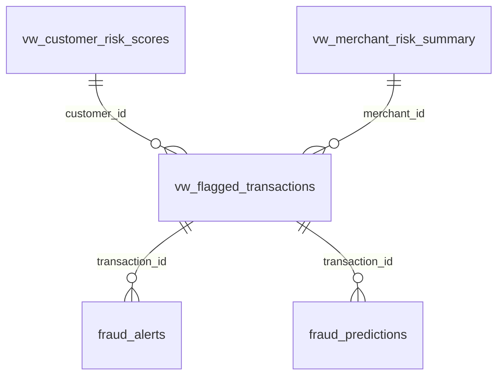

# FraudShield AI: Power BI Desktop Connection & Dashboard Guide

This guide details how to connect **Power BI Desktop** to your local **PostgreSQL 17** `fraud_db` database and recreate the executive surveillance dashboard, KPI cards, volume trend lines, and forensic drill-down matrices.

---

## 🔌 1. Prerequisites & PostgreSQL Driver

1. **Power BI Desktop**: Install the latest version from Microsoft Store or [Power BI Desktop Download](https://powerbi.microsoft.com/desktop/).
2. **Npgsql / PostgreSQL Connector**:
   - Power BI uses the Npgsql connector. If prompted for an installation, install the [Npgsql .NET Data Provider for PostgreSQL](https://github.com/npgsql/npgsql/releases) (ensure **GAC Installation** is checked during setup).
   - Alternatively, use the standard Windows ODBC Driver for PostgreSQL (psqlODBC 64-bit).

---

## 🗄️ 2. Connecting Power BI to `fraud_db`

1. Open **Power BI Desktop** and click **Get Data** -> **More...**
2. Search for **PostgreSQL database** and click **Connect**.
3. In the PostgreSQL connection dialog, enter:
   - **Server:** `localhost:5432`
   - **Database:** `fraud_db`
   - **Data Connectivity mode:** Select **Import** (recommended for interactive charting) or **DirectQuery** (for near real-time live streaming).
   - *(Optional under Advanced options)*: Leave SQL statement blank to browse tables/views.
4. When prompted for credentials, select the **Database** tab:
   - **User name:** `postgres`
   - **Password:** `password` *(or the password configured in your `.env`)*
5. Click **Connect**. If a prompt warns that the connection is unencrypted, click **OK** to proceed for local environments.

---

## 📊 3. Selecting Analytical Views & Tables

In the Navigator window, select the following pre-aggregated analytical views and tables:

| Entity Name | Type | Description |
|---|---|---|
| `vw_flagged_transactions` | SQL View | Real-time surveillance view with `LAG` metrics, rolling averages, and spike ratios |
| `vw_customer_risk_scores` | SQL View | Customer 360 portfolio metrics, composite risk ranking, and percentiles |
| `vw_merchant_risk_summary` | SQL View | Merchant category peer benchmarks, dispute rates, and fraud density |
| `fraud_alerts` | Table | Complete rule and ML security alerts |
| `fraud_predictions` | Table | ML inference probabilities, risk tiers, and SHAP feature attributions |

Click **Load** (or **Transform Data** to verify column data types).

---

## 🔗 4. Data Modeling & Relationships (Model View)

Navigate to the **Model View** tab on the left pane and verify or create the following one-to-many (`1:*`) relationships:



1. **`vw_customer_risk_scores[customer_id]`** -> **`vw_flagged_transactions[customer_id]`** (Single direction, 1 to many).
2. **`vw_merchant_risk_summary[merchant_id]`** -> **`vw_flagged_transactions[merchant_id]`** (Single direction, 1 to many).
3. **`vw_flagged_transactions[transaction_id]`** -> **`fraud_alerts[transaction_id]`** (1 to many).
4. **`vw_flagged_transactions[transaction_id]`** -> **`fraud_predictions[transaction_id]`** (1 to 1).

---

## 🧮 5. Core DAX Measures

In Power BI, click **New Measure** on the Home ribbon and paste the following DAX calculations:

### 1. Total Transactions
```dax
Total Transactions = COUNTROWS(vw_flagged_transactions)
```

### 2. Total Settled Volume (USD)
```dax
Total Settled Volume = SUM(vw_flagged_transactions[amount])
```

### 3. Confirmed Fraud Volume (USD)
```dax
Total Fraud Volume = 
CALCULATE(
    SUM(vw_flagged_transactions[amount]), 
    vw_flagged_transactions[ground_truth_fraud] = TRUE()
)
```

### 4. Fraud Volume Exposure Rate (%)
```dax
Fraud Exposure Rate = 
DIVIDE([Total Fraud Volume], [Total Settled Volume], 0)
```

### 5. High-Risk Alert Count
```dax
High-Risk Alerts = 
CALCULATE(
    COUNTROWS(fraud_alerts), 
    fraud_alerts[severity] IN {"CRITICAL", "HIGH"}
)
```

### 6. Average Ticket Size
```dax
Average Ticket Size = AVERAGE(vw_flagged_transactions[amount])
```

---

## 📈 6. Recreating the Executive Visuals

### Visual 1: Executive KPI Cards (Card or Multi-Row Card)
- Add a **Card** visual with `[Total Transactions]` (Formatted as `#,##0`).
- Add a **Card** visual with `[Total Settled Volume]` (Display units: Millions, `$#,##0.00 M`).
- Add a **Card** visual with `[Total Fraud Volume]` (Display units: Thousands, Callout color: `#EF4444`).
- Add a **Card** visual with `[Fraud Exposure Rate]` (Format as Percentage, `0.00%`).

### Visual 2: 31-Day Financial Volume vs. Fraud Exposure (Line and Stacked Column Chart)
- **X-Axis:** `vw_flagged_transactions[timestamp]` (Hierarchy by Day or Step).
- **Column Y-Axis:** `[Total Settled Volume]` (Bar color: `#3B82F6` Soft Blue).
- **Line Y-Axis:** `[Total Fraud Volume]` (Line color: `#EF4444` Crimson Red, Stroke width: 3).

### Visual 3: Model Risk Tier Breakdown (Donut Chart)
- **Legend:** `fraud_predictions[risk_tier]`.
- **Values:** `COUNT(fraud_predictions[prediction_id])`.
- **Color Mapping:**
  - `CRITICAL`: `#EF4444` (Red)
  - `HIGH`: `#F97316` (Orange)
  - `MEDIUM`: `#EAB308` (Yellow)
  - `LOW`: `#22C55E` (Green)

### Visual 4: Merchant Risk Category Peer Matrix (Table / Matrix Visual)
- **Rows:** `vw_merchant_risk_summary[category_name]`, `vw_merchant_risk_summary[merchant_name]`.
- **Values:**
  - `vw_merchant_risk_summary[total_settled_volume]`
  - `vw_merchant_risk_summary[confirmed_fraud_txns]`
  - `vw_merchant_risk_summary[alert_rate_pct]`
  - `vw_merchant_risk_summary[category_risk_rank]`
- **Conditional Formatting:** Apply Data Bars or Background Color gradient on `alert_rate_pct`.

### Visual 5: Behavioral Outlier Scatter Plot
- **X-Axis:** `vw_flagged_transactions[amount]`.
- **Y-Axis:** `vw_flagged_transactions[spending_spike_ratio]`.
- **Legend / Color:** `vw_flagged_transactions[surveillance_verdict]`.
- **Tooltip:** `customer_name`, `account_number`, `merchant_name`.

---

## 🔄 7. Scheduled Refresh & DirectQuery Configuration

- If using **DirectQuery**, Power BI queries PostgreSQL in real time whenever filters or slicers change.
- If using **Import**, set up scheduled refresh in the Power BI Service via an **On-Premises Data Gateway** pointing to your local PostgreSQL instance on `localhost:5432`.
